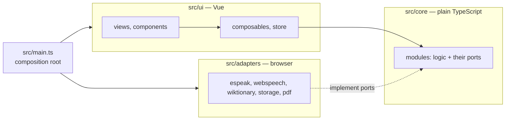
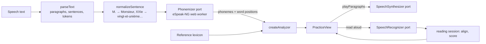

# Contributing to Discours

Thank you for helping. This guide explains how to set up the project, how the code is organized
and how it works, and what a change needs before it can be merged. To run the app and try it, see
the [README](README.md) first.

The project lives on [GitLab](https://depot.lipn.univ-paris13.fr/teaching-apps/discours): issues and merge requests go there. The GitHub repository is a
read-only mirror (see [The GitHub mirror](#the-github-mirror)).

## Contents

- [Getting set up](#getting-set-up)
- [Architecture](#architecture)
- [Project structure](#project-structure)
- [How it works](#how-it-works)
- [Making a change](#making-a-change)
- [Checks before you push](#checks-before-you-push)
- [Development notes](#development-notes)
- [Common tasks](#common-tasks)
- [Commits and merge requests](#commits-and-merge-requests)
- [The GitHub mirror](#the-github-mirror)
- [Reporting a problem](#reporting-a-problem)
- [Licence of contributions](#licence-of-contributions)

## Getting set up

Requirements: Node.js 22.18+ or 24.12+, and Chrome or Edge to try speech recognition.

```sh
npm install
npm run dev
```

`npm run dev` first builds the French eSpeak-NG bundle (`npm run espeak`), then starts Vite. The
generated files (`src/adapters/espeak/vendor/espeak-ng-fr.js`, `public/espeak/`) are ignored by
git; don't commit them.

| Command              | What it does                                                   |
| -------------------- | -------------------------------------------------------------- |
| `npm run dev`        | Development server with hot reload                             |
| `npm run build`      | Type-check and production build in `dist/`                     |
| `npm run preview`    | Serve the production build                                     |
| `npm test`           | Unit and adapter tests (Vitest)                                |
| `npm run test:watch` | The tests, run again on every change                           |
| `npm run type-check` | TypeScript, for the app and the tests                          |
| `npm run lint`       | oxlint then ESLint, with fixes                                 |
| `npm run format`     | Prettier on `src/` and `tests/`                                |
| `npm run espeak`     | Rebuild the French eSpeak-NG bundle (run by `dev` and `build`) |
| `npm run docs`       | Generate the API documentation in `docs/api/` (TypeDoc)        |
| `npm run deploy`     | Build for a sub-path and copy into a folder of apps            |

**Stack:** Vue 3 (`<script setup>`), TypeScript, Pinia, Vue Router, Vite; Vitest for the tests.

## Architecture

The code follows **ports and adapters** (hexagonal architecture): the logic doesn't know about
Vue, the DOM or the browser's APIs, and talks to the outside world through interfaces, the
**ports**. Each module of the core declares the ports it needs, next to the logic that uses them.



| Folder          | Contains                                                                                 | May import                          |
| --------------- | ---------------------------------------------------------------------------------------- | ----------------------------------- |
| `src/core/`     | Logic as pure functions and plain data, and the **ports** (interfaces) each module needs | other core modules only             |
| `src/adapters/` | Browser implementations of the ports                                                     | `src/core`, browser APIs, libraries |
| `src/ui/`       | Vue: screens, components, composables, the Pinia store                                   | `src/core`, Vue                     |
| `src/main.ts`   | The composition root: creates adapters, starts the app                                   | everything                          |
| `tests/`        | Unit tests (Vitest), mirroring `src/`                                                    | `src`, through the aliases          |

| Module (`src/core/…`) | Logic                                               | Ports                                   | Adapter (`src/adapters/…`)                                        |
| --------------------- | --------------------------------------------------- | --------------------------------------- | ----------------------------------------------------------------- |
| `phonetics/`          | `createAnalyzer`: IPA, syllables, liaisons; lexicon | `Phonemizer`                            | `espeak/EspeakPhonemizer` (eSpeak-NG in a web worker)             |
| `reading/`            | alignment, reading sessions, scores, playback       | `SpeechSynthesizer`, `SpeechRecognizer` | `webspeech/WebSpeechSynthesizer`, `webspeech/WebSpeechRecognizer` |
| `dictionary/`         | —                                                   | `Dictionary`                            | `wiktionary/WiktionaryDictionary`                                 |
| `state/`              | saved state and settings                            | `StateStorage`                          | `storage/LocalStorageStateStorage`                                |
| `print/`              | pagination, file names, PDF writer and export       | `PageRasterizer`                        | `pdf/HtmlToImageRasterizer` (html-to-image)                       |
| `text/`               | tokenizer, normalization, numbers, word keys        | —                                       | —                                                                 |
| `speech/`             | sections, display units, spoken text                | —                                       | —                                                                 |
| `progress/`           | best scores, words to work on, IPA corrections      | —                                       | —                                                                 |

- **`src/core/`**: the domain, as pure functions and plain data. `model.ts` is the data model
  (`AnalyzedParagraph`, `WordItem`…); `ports.ts` lists every port the app needs (`Ports`).
- **`src/adapters/`**: the browser implementation of each port. `index.ts` assembles them
  (`createBrowserPorts`).
- **`src/ui/`**: Vue only. Screens and components display state and forward user actions. The
  composables (`useModelVoice`, `useReadingSession`) and the Pinia store turn core functions and
  ports into reactive state. The UI gets the ports with `usePorts()`, never an adapter.
- **`src/main.ts`**: the composition root, the only place that sees both adapters and UI.

**Imports.** Each layer has an import alias, declared once in the `imports` field of
`package.json` (Node's subpath imports, which TypeScript, Vite, Vitest and TypeDoc all read):
`#core/…`, `#adapters/…` and `#ui/…` (for example `import { wordKey } from '#core/text/words'`).
Imports that leave their folder use an alias; `./` is only for a file in the same folder, and
`../` is not allowed.

**Dependencies point inward**: the core imports nothing from the UI or the adapters, adapters
don't import the UI, and the UI imports no adapter. ESLint enforces it (`no-restricted-imports` in
`eslint.config.ts`): `npm run lint` fails if the core imports Vue, the UI or an adapter, if an
adapter imports the UI, or if the UI imports an adapter.

**Extending.** To use another engine (a cloud text-to-speech voice, another phonemizer, another
dictionary, server-side storage), write a class implementing the port in `src/adapters/` and use
it in `createBrowserPorts()`. Nothing else changes. Tests use the same mechanism with fakes.

### Where code goes

- **A rule, a computation, a format?** It goes in `src/core`, as a pure function with a test.
  Components only display state and forward user actions.
- **Something from the browser or the network?** Declare what the core needs as an interface in
  the module that uses it (like `Phonemizer` in `core/phonetics/`), implement it in
  `src/adapters/`, and add it to `Ports` (`src/core/ports.ts`) and `createBrowserPorts()`
  (`src/adapters/index.ts`). The UI gets it with `usePorts()`.
- **Reactive state for several components?** A composable in `src/ui/composables/`, or the store
  in `src/ui/stores/discours.ts` if it must be saved.
- **Component props and events** are typed in `src/ui/types/components.ts` (and shared UI types
  in `src/ui/types/`), not inline in the `.vue` file, so a parent and its child use the same
  types: `defineProps<SpeechTextProps>()`, `defineEmits<SpeechTextEmits>()`.
- **A screen growing large?** Split it into components that take props and emit events; the
  screen keeps the state (store, composables) and passes it down, as `PracticeView` does.
- **A value that may be absent** is typed `Nullable<T>` (from `#core/types`), not `T | null`.
- **Text the user sees** is in French; code, comments and documentation are in English.

## Project structure

```text
.github/                  the GitHub mirror only: redirection to GitLab
scripts/
  build-espeak-fr.mjs     French-only eSpeak-NG bundle (data trimming + module patch)
  deploy.sh               build for a sub-path and copy into a folder of apps
  docs-components.mjs     Vue components page of the API documentation
src/
  main.ts                 composition root: adapters → ports → Vue app
  core/                   plain TypeScript: no Vue, no DOM; each module with its ports
    model.ts              AnalyzedParagraph, WordItem…
    ports.ts              Ports: every port the app needs
    errors.ts             errorMessage: the message of a caught error
    types.ts              Nullable
    text/                 tokenizer and normalization, numbers in words, word keys
    phonetics/            createAnalyzer (IPA, liaisons), syllables, lexicon; Phonemizer
    reading/              alignment, reading sessions and scores, playback;
                          SpeechSynthesizer, SpeechRecognizer
    dictionary/           Dictionary
    state/                saved state and settings; StateStorage
    print/                pagination, paper sizes, file names, PDF writer and export;
                          PageRasterizer
    speech/               sections, display units, spoken text
    progress/             best scores, words to work on, IPA corrections
  adapters/               the ports, implemented for the browser
    index.ts              createBrowserPorts()
    espeak/               EspeakPhonemizer, web worker, engine, generated vendor module
    webspeech/            WebSpeechSynthesizer, WebSpeechRecognizer
    wiktionary/           WiktionaryDictionary
    storage/              LocalStorageStateStorage
    pdf/                  HtmlToImageRasterizer
  ui/                     Vue
    views/                PracticeView (/), DocumentView (/discours), EditorView (/texte),
                          PrintView (/pdf)
    components/           SpeechText, WordPractice, IpaEditor, WordDefinition,
                          HardWordsPanel, PrintParagraph, PrintDocBlock;
                          the training screen's parts: ParagraphSidebar
                          (OverallProgress, ParagraphList), MobileHeader,
                          PracticeSettings (ToggleSwitch), ReadingControls,
                          ReadingSummary, HeardTranscript, PracticeLegend
    composables/          usePorts / providePorts, useModelVoice, useVoices,
                          useReadingSession
    stores/discours.ts    Pinia store: reactive state over the modules and ports
    types/                shared UI types: component props and events, word panel, PDF
    utils/                format (durations, labels, messages in French), download
    content/              the example speech
    router/, assets/      routes, CSS, logo
public/espeak/            generated French data package, git-ignored
tests/
  core/                   unit tests of the core (Vitest), with fake adapters
  adapters/               adapter tests: fakes of the browser APIs, real eSpeak
```

Every module, exported function and type is documented with [TSDoc](https://tsdoc.org) comments.
Start with `src/core/ports.ts` for the ports and `src/core/phonetics/analyze.ts` for the
pipeline. Run `npm run docs` to browse them as HTML pages.

## How it works

### Overview



### IPA transcription

1. **Parsing** (`src/core/text/normalize.ts`). The text is split into paragraphs, sentences and
   tokens (words, punctuation, reading marks), keeping the original spacing.
2. **Normalization.** eSpeak-NG reads some written forms badly, so they are rewritten first:
   _M._ → Monsieur, _XXIe_ / _21e_ → vingt-et-unième, _Louis XIV_ → Louis 14, _PIB_ → pé-i-bé,
   _1 200 000_ → 1200000, _qu'aujourd'hui_. A character map keeps track of which original word
   each character comes from.
3. **Phonemization** (the `Phonemizer` port, implemented by `src/adapters/espeak/`). eSpeak-NG
   runs in a web worker. Its synthesis events give every phoneme along with the position of the
   word that produced it, which is how the IPA is aligned word by word. The audio is thrown away.
4. **Choosing the IPA** (`src/core/phonetics/analyze.ts`). If the word is in the hand-checked
   lexicon (`src/core/phonetics/lexicon.ts`, about 600 words split into syllables), its entry is
   used. Otherwise eSpeak's phonemes are cleaned up (stress marks removed, ɥ restored in _suis_,
   _nuit_) and split into syllables.
5. **Liaisons.** Every distinct word is also phonemized on its own. A final consonant that only
   appears in context is a liaison (_les_ /le/, _les enfants_ /lez‿ɑ̃fɑ̃/). A pronounced final
   consonant before a vowel is an enchaînement (_avec‿elle_).

The French eSpeak data is cut down from 23 MB (all languages) to about 700 KB by
`scripts/build-espeak-fr.mjs`. It loads in the background when the app starts, and a 750-word
speech is analyzed in under a second.

### Model voice

`src/adapters/webspeech/WebSpeechSynthesizer.ts` uses the browser's speech synthesis. It prefers
fr-FR voices, _Google français_ first, then Thomas, Amélie, Denise or Henri. A different voice can
be picked in the toolbar.

The whole paragraph is spoken as **one utterance**, which keeps intonation natural across
sentences. `/` becomes a comma and `//` an ellipsis, which the voice reads as pauses, unless
punctuation already marks a pause there (`spokenText`, `src/core/speech/units.ts`). Word boundary
events drive the highlighting. `playParagraphs` (`src/core/reading/playback.ts`) plays one or
more paragraphs in a row, for both the training and the whole speech screens.

### Whole speech

`src/ui/views/DocumentView.vue` (route `/discours`) shows all paragraphs, grouped by section.
Clicking a paragraph number makes it the starting point.

- **Écouter** speaks the paragraphs one after the other, one utterance each (the same text as on
  the training screen), with a short silence between paragraphs and a longer one before a new
  section. The current paragraph is scrolled into view.
- **Lire à voix haute** runs one continuous recognition session and aligns the transcript with
  all the words from the starting paragraph on (a `ReadingTarget` spanning several paragraphs),
  so the reader can stop wherever they like. On _Terminer la lecture_, every paragraph up to the
  last word heard gets its own score, exactly as if it had been read alone, and its missed words
  go to the words to work on. A summary gives the overall score, time and words per minute.
  Space starts and ends the reading.

### Definitions

The `Dictionary` port is implemented by `src/adapters/wiktionary/WiktionaryDictionary.ts`, which
fetches the word's page from the French Wiktionary through the MediaWiki API (`action=parse`,
which allows browser requests with `origin=*`) and reads, in the French section, the numbered
definitions of each part of speech with their first example. It tries the word as written,
without an elided article or pronoun (_l'application_ → _application_), and in lower case. When
every definition only points to another word (_Pluriel de recherche_), the base word's page is
fetched too; "form of" lines are dropped when the page has real definitions. At most 3 parts of
speech and 4 meanings each are shown, with a link to the full page (content under CC BY-SA).
Results are cached for the session.

The word is sent to Wikimedia when the panel opens. Technical terms (acronyms, numbers) are not
looked up. Without a connection, the panel says the definition is unavailable.

### Reading score

The `SpeechRecognizer` port (Web Speech API in the browser) gives the transcript.
`src/core/reading/align.ts` aligns it with the words read by longest common subsequence, with a
tolerant comparison:

- Words are compared without accents or punctuation.
- Elisions are matched part by part: _l'équipe_ → `l` + `equipe`.
- Plural, feminine and verb endings are ignored (_arrivé_ = _arrivés_).

A word is _understood_ when all its parts were heard. Technical terms (acronyms such as _CNRS_,
alphanumeric terms) are shown in italics and **not counted** in the score: recognizers transcribe
them unpredictably. Only the best score of each paragraph is kept.

The training screen and the whole speech screen share the same rules
(`src/core/reading/session.ts`): `readingTarget` covers one paragraph or several, `followReading`
colours the words live, and `scoreReading` scores each paragraph as if read alone.

### PDF

`src/ui/views/PrintView.vue` (route `/pdf`) lays both templates out as exact A4 pages:

- **Fiches**: one card per section, two A5 landscape cards per A4 page, with a cut line. The rail
  on the left shows the section number and title. Each card has tick boxes for rehearsals, the
  reading time at 135 words per minute and, on the section's last card, its words to work on. A
  section too long for one card continues on the next (1/2, 2/2).
- **Document**: A4 pages with a legend of the marks and page numbers. A paragraph is never split
  across pages, and a section title never ends a page.

The view measures every paragraph and title at final size in a hidden box, then `fillPages`
(`src/core/print/pagination.ts`) fills the cards or pages. Each page is captured as a 240 dpi JPEG
by the `PageRasterizer` port ([html-to-image](https://github.com/bubkoo/html-to-image) in the
browser), and `src/core/print/pdfWriter.ts` writes the PDF itself (one image per page, about
450 KB per page).

The web fonts are embedded in the capture, which is why the Google Fonts stylesheet is loaded with
`crossorigin` in `index.html`. `?partie=2` preselects the second section and `?modele=document`
the document template.

### Stored data

Everything goes through the `StateStorage` port: the browser's `localStorage`, under the key
`discours:v2`. It holds the speech text; the settings (IPA and liaison display, rate, voice); the
current paragraph; the best scores, words to work on and per-word practice statistics; and the
IPA corrections. Scores are tied to the paragraph text: editing a paragraph resets its score.

### Deployment

`scripts/deploy.sh` builds with `BASE_PATH` (default `/apps/discours/`, read by `vite.config.ts`),
syncs `dist/` into `<folder>/discours/` with `rsync --delete`, and writes an `.htaccess` that
rewrites inner routes to `index.html` on Apache.

On static hosts without rewrites, unknown paths must get the app too: copy `index.html` to
`404.html`. Alternatively, a `404.html` can store the requested path in
`sessionStorage` (`spa-redirect`) and redirect to the app's root: the first script in
`index.html` restores the path.

## Making a change

1. Create a branch from `main`.
2. Make the change in the right layer (see [Where code goes](#where-code-goes)). Keep functions
   small and named after what they do; prefer a new pure function in the core to logic inside a
   component.
3. Add or update tests in `tests/` for any change in `src/core`. Ports make the logic testable
   without a browser: use a fake adapter, as `tests/core/analyze.test.ts` does for the
   `Phonemizer`.
4. Document every exported function, type and member with a [TSDoc](https://tsdoc.org) comment,
   and give each new file a header comment. Vue components need a header comment in
   `<script setup>` and a comment on each prop and event: they feed the _Vue components_ page of
   the API documentation.
5. Update the README if you change what a user sees, a command or the configuration; update this
   guide if you change the architecture or the project structure. Describe any change a user
   would notice under _Unreleased_ in [CHANGELOG.md](CHANGELOG.md).
6. Try the change in Chrome with `npm run dev`. For the PDF export and the deployment path, check
   a production build too (`npm run build`, then `npm run preview`).

## Checks before you push

All of these must pass:

```sh
npm run type-check   # TypeScript, app and tests
npm run lint         # oxlint, then ESLint (with architecture rules)
npm test             # unit tests
npm run build        # production build
npm run docs         # API documentation: must report no warnings
```

`npm run format` formats `src/` and `tests/` with Prettier (no semicolons, single quotes, 100
columns). `npm run docs` warns about any undocumented export.

## Development notes

- **Tests** run in Node with [Vitest](https://vitest.dev). The core is tested with fake adapters
  for the ports (`tests/core/`); the adapters with fakes of the browser APIs, and eSpeak for real
  (`tests/adapters/`).
- **Running the real analyzer in Node:** `createAnalyzer` takes any `Phonemizer`. Load
  `src/adapters/espeak/vendor/espeak-ng-fr.js` in Node, with `locateFile` pointing to
  `public/espeak/`, and wrap its `synthesize` phoneme events in a `Phonemizer`.
- **Generated files:** `src/adapters/espeak/vendor/espeak-ng-fr.js` and `public/espeak/` are
  generated and ignored by git and the linters.
- **API documentation:** `npm run docs` generates an HTML site in `docs/api/` with
  [TypeDoc](https://typedoc.org) (open `docs/api/index.html`). The configuration is in
  `typedoc.json`; every exported function, type and member must be documented (TypeDoc's
  `notDocumented` check warns otherwise). TypeDoc reads only the TypeScript modules, through
  `tsconfig.docs.json` and a `.vue` declaration in `env.docs.d.ts`. The Vue components are covered
  by `scripts/docs-components.mjs`, run first, which writes `docs/components.md` from each
  component's header comment, props (inline, or the named type from `src/ui/types/`), `v-model`s,
  events and exposed methods; TypeDoc adds it as the _Vue components_ page, next to this guide.
  New TypeScript modules under `src/` are picked up automatically.

## Common tasks

- **Fix a pronunciation for everyone:** add the word to `LEXICON` in
  `src/core/phonetics/lexicon.ts`, split into syllables with dots (`a.pʁɑ̃.ti.saʒ`). Corrections
  made in the app stay in the user's browser.
- **Read a new written form correctly** (abbreviation, number format…): extend `normalizeWord` in
  `src/core/text/normalize.ts`, with a test in `tests/core/normalize.test.ts`.
- **Use another engine** (voice, phonemizer, dictionary, storage): write a class implementing the
  port in `src/adapters/`, then use it in `createBrowserPorts()`. Nothing else should change.
- **Add a screen:** a view in `src/ui/views/`, a route in `src/ui/router/index.ts`, and its
  logic in `src/core`.
- **Upgrade eSpeak-NG:** update `@echogarden/espeak-ng-emscripten`, then run `npm run espeak`.
  The script fails loudly if the upstream module layout changed.

## Commits and merge requests

Open merge requests on [GitLab](https://depot.lipn.univ-paris13.fr/teaching-apps/discours/-/merge_requests).

- Write commit messages in the [Conventional Commits](https://www.conventionalcommits.org) style
  used in the history: `feat: …`, `fix: …`, `refactor: …`, `docs: …`, `test: …`, `chore: …`.
- Keep a merge request to one topic. Describe what changes for the user, and how you tested it
  (browser, screens, speech recognition or not).
- Include a screenshot for visual changes.

## The GitHub mirror

GitLab pushes `main` to GitHub after every change (a push mirror). Nothing is ever committed on
GitHub: the mirror would overwrite it. The `.github/` folder, ignored by GitLab, holds what only
GitHub uses:

- `workflows/redirect-to-gitlab.yml` answers any issue or pull request opened on GitHub with a
  link to GitLab, and closes it;
- `ISSUE_TEMPLATE/config.yml` replaces GitHub's issue form with a link to GitLab.

## Reporting a problem

Open an [issue on GitLab](https://depot.lipn.univ-paris13.fr/teaching-apps/discours/-/issues) with:

- what you did, what you expected and what happened;
- the browser and system (speech features depend on them);
- for a wrong pronunciation: the word, the sentence it is in, the IPA shown and the IPA expected.

## Licence of contributions

Discours is released under the GNU General Public License, version 3 or (at your option)
any later version. By contributing, you agree that your contribution is released under the same
licence. See [LICENSE](LICENSE).
