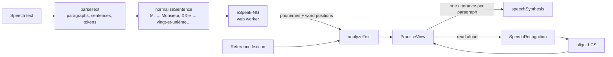

<p align="center"></p>

# Discours

A web app for practising French pronunciation of a speech. Paste your text and each word is shown
with its pronunciation in the International Phonetic Alphabet (IPA, _API_ in French), plus the
liaisons to make. You can listen to a model voice, read aloud and see which words were understood,
then work on the difficult ones one by one.

The training screen and its engines follow an earlier single-page prototype,
_Entrainement prononciation_, generalized to any speech.

## Contents

- [Features](#features)
- [Getting started](#getting-started)
- [Deployment](#deployment)
- [PDF](#pdf)
- [Writing a speech](#writing-a-speech)
- [How it works](#how-it-works)
- [Project structure](#project-structure)
- [Development](#development)
- [Limitations](#limitations)
- [Licence](#licence)

## Features

- **IPA under each word**, split into syllables (`/a.pʁɑ̃.ti.saʒ/`). It comes from a hand-checked
  lexicon when the word is in it, otherwise from eSpeak-NG.
- **Liaisons and enchaînements**: `‿z` after _les_ in _les enfants_, `‿` after _avec_ in
  _avec elle_.
- **Model voice**: the paragraph is read in a single utterance by the best French voice in the
  browser, and the word being spoken is highlighted. The rate is adjustable (0.6× to 1.1×).
- **Read aloud**: speech recognition follows your reading. Words turn green when understood and
  red when missed, live. At the end you get a score, the reading time and your words per minute
  (target ≈ 135).
- **Whole speech**: _Discours entier_ shows every paragraph on one page. Listen to it from start
  to finish, or read it aloud in one go: the page follows you, and each paragraph you reach is
  scored.
- **Words to work on**: missed words are collected in a list. Click one (or any word in the text)
  to hear it, hear it slowly, and repeat it until it's recognized.
- **Definitions**: the word panel also shows the word's French meanings, from the
  [Wiktionnaire](https://fr.wiktionary.org). Inflected forms lead to their base word
  (_recherches_ → _recherche_, _remercie_ → _remercier_).
- **IPA corrections**: if a transcription is wrong, click the word and correct it. The correction
  applies everywhere the word appears.
- **Progress is saved** in the browser: best score per paragraph, words to work on, per-word
  success rate.
- **PDF**: the whole speech or one section, as training cards (two A5 cards per A4 page, one per
  section, to cut out) or as a numbered A4 document, with the IPA, liaisons and pauses.

## Getting started

Requirements: Node.js 22.18+ or 24.12+.

```sh
npm install
npm run dev
```

Then open the URL shown by Vite **in Google Chrome or Microsoft Edge**. Speech recognition is not
available in Safari or Firefox; the model voice and the IPA still work there.

The microphone is needed for _Lire à voix haute_ and _Répéter_. Allow it when the browser asks.

| Command           | What it does                                                    |
| ----------------- | --------------------------------------------------------------- |
| `npm run dev`     | Development server with hot reload                              |
| `npm run build`   | Type-check and production build in `dist/`                      |
| `npm run preview` | Serve the production build                                      |
| `npm run lint`    | oxlint then ESLint, with fixes                                  |
| `npm run format`  | Prettier on `src/`                                              |
| `npm run espeak`  | Rebuild the French eSpeak-NG bundle (run by `dev` and `build`)  |
| `npm run docs`    | Generate the API documentation in `docs/api/` (TypeDoc)         |
| `npm run deploy`  | Build for a sub-path and copy into a folder of apps (see below) |

## Deployment

`npm run deploy` builds the app for a sub-path and copies it into a folder of static apps:

```sh
npm run deploy -- /path/to/apps        # installs into /path/to/apps/discours
DEPLOY_DIR=/path/to/apps npm run deploy
```

To avoid typing the path, set it once in a `.deploy.local` file at the project root (git-ignored):

```sh
DEPLOY_DIR=/path/to/apps
```

The app is built with the public path `/apps/discours/` (change it with `BASE_PATH`, read by
`vite.config.ts`). `scripts/deploy.sh` syncs `dist/` into `<folder>/discours/`, removing files from
older builds, and writes an `.htaccess`. Publishing the folder is up to you.

Links to inner pages (such as `/apps/discours/texte`) work in two ways:

- on Apache, through the `.htaccess` rewrite to `index.html`;
- on static hosts without rewrites (GitHub Pages), through a `404.html` that stores the requested
  path in `sessionStorage` (`spa-redirect`) and redirects to the app. The first script in
  `index.html` restores the path.

## PDF

**⤓ Télécharger en PDF** in the sidebar opens the PDF screen (route `/pdf`). Choose what to
include (the whole speech or one section), the template, the text size, and what to show (IPA,
liaisons, pauses, words to work on), then **Télécharger le PDF**. The preview shows the exact
pages of the PDF.

- **Fiches**: one card per section, two A5 landscape cards per A4 page, with a cut line. The rail
  on the left shows the section number and title. Each card has tick boxes for rehearsals, the
  reading time at 135 words per minute and, on the section's last card, its words to work on. A
  section too long for one card continues on the next (1/2, 2/2).
- **Document**: A4 pages with a legend of the marks and page numbers. A paragraph is never split
  across pages, and a section title never ends a page.

Both templates are laid out as exact A4 pages: `PrintView.vue` measures every paragraph and title
at final size in a hidden box, then fills the cards or pages. `src/pdf.ts` captures each page as
a 240 dpi JPEG with [html-to-image](https://github.com/bubkoo/html-to-image) and writes the PDF
itself (one image per page, about 450 KB per page). The PDF looks exactly like the preview, but
its text can't be selected or searched.

The web fonts are embedded in the capture, which is why the Google Fonts stylesheet is loaded with
`crossorigin` in `index.html`. Without a connection, system fonts are used.

`?partie=2` preselects the second section and `?modele=document` the document template. The old
`/imprimer` links redirect to `/pdf`.

## Writing a speech

Click **Modifier le texte** in the sidebar. The format is plain text:

```text
# Introduction
Mesdames et Messieurs les membres du jury, / je vous remercie de m'accueillir. //
Je vais d'abord vous présenter mon parcours. [→]
# Parcours
Depuis mon arrivée au laboratoire, / mes travaux portent sur…
```

- **One paragraph per line.** A paragraph is the unit you listen to, read and get scored on.
- **`# Title`** starts a section. Paragraphs are grouped under it in the sidebar.
- **`/`** marks a short pause and **`//`** a long one. The model voice respects them.
- **`[→]`** marks a slide change. It is shown but not read.

The text is saved as you type.

## How it works

### Overview



### IPA transcription

1. **Parsing** (`src/phonetics/normalize.ts`). The text is split into paragraphs, sentences and
   tokens (words, punctuation, reading marks), keeping the original spacing.
2. **Normalization.** eSpeak-NG reads some written forms badly, so they are rewritten first:
   _M._ → Monsieur, _XXIe_ / _21e_ → vingt-et-unième, _Louis XIV_ → Louis 14, _PIB_ → pé-i-bé,
   _1 200 000_ → 1200000, _qu'aujourd'hui_. A character map keeps track of which original word
   each character comes from.
3. **Phonemization** (`src/phonetics/espeak.ts`). eSpeak-NG runs in a web worker
   (`espeak.worker.ts`). Its synthesis events give every phoneme along with the position of the
   word that produced it, which is how the IPA is aligned word by word. The audio is thrown away.
4. **Choosing the IPA** (`src/phonetics/analyze.ts`). If the word is in the hand-checked lexicon
   (`src/phonetics/lexicon.ts`, about 600 hand-checked words split into syllables), its entry is
   used. Otherwise eSpeak's phonemes are cleaned up (stress marks removed, ɥ restored in _suis_,
   _nuit_) and split into syllables.
5. **Liaisons.** Every distinct word is also phonemized on its own. A final consonant that only
   appears in context is a liaison (_les_ /le/, _les enfants_ /lez‿ɑ̃fɑ̃/). A pronounced final
   consonant before a vowel is an enchaînement (_avec‿elle_).

The French eSpeak data is cut down from 23 MB (all languages) to about 700 KB by
`scripts/build-espeak-fr.mjs`. It loads in the background when the app starts, and a 750-word
speech is analyzed in under a second.

### Model voice

`src/composables/useSpeech.ts` uses the browser's speech synthesis, with the same voice choice as
the prototype: fr-FR voices, _Google français_ first, then Thomas, Amélie, Denise or Henri. A
different voice can be picked in the toolbar.

The whole paragraph is spoken as **one utterance**, which keeps intonation natural across
sentences. `/` becomes a comma and `//` an ellipsis, which the voice reads as pauses. Word boundary
events drive the highlighting.

### Whole speech

`src/views/DocumentView.vue` (route `/discours`) shows all paragraphs, grouped by section.
Clicking a paragraph number makes it the starting point.

- **Écouter** speaks the paragraphs one after the other, one utterance each (the same text as on
  the training screen, `spokenText` in `src/practice/units.ts`), with a short silence between
  paragraphs and a longer one before a new section. The current paragraph is scrolled into view.
- **Lire à voix haute** runs one continuous recognition session and aligns the transcript with
  all the words from the starting paragraph on, so you can stop wherever you like. On
  _Terminer la lecture_, every paragraph up to the last word heard gets its own score, exactly as
  if it had been read alone, and its missed words go to the words to work on. A summary gives the
  overall score, time and words per minute. Space starts and ends the reading.

### Definitions

`src/practice/dictionary.ts` fetches the word's page from the French Wiktionary through the
MediaWiki API (`action=parse`, which allows browser requests with `origin=*`) and reads, in the
French section, the numbered definitions of each part of speech with their first example. It
tries the word as written, without an elided article or pronoun (_l'application_ →
_application_), and in lower case. When every definition only points to another word (_Pluriel
de recherche_), the base word's page is fetched too; "form of" lines are dropped when the page
has real definitions. At most 3 parts of speech and 4 meanings each are shown, with a link to the
full page (content under CC BY-SA). Results are cached for the session.

The word is sent to Wikimedia when the panel opens. Technical terms (acronyms, numbers) are not
looked up. Without a connection, the panel says the definition is unavailable.

### Reading score

`src/composables/useRecognition.ts` runs continuous French speech recognition.
`src/practice/align.ts` aligns the transcript with the paragraph's words by longest common
subsequence, with a tolerant comparison. This is the prototype's algorithm:

- Words are compared without accents or punctuation.
- Elisions are matched part by part: _l'équipe_ → `l` + `equipe`.
- Plural, feminine and verb endings are ignored (_arrivé_ = _arrivés_).

A word is _understood_ when all its parts were heard. Technical terms (acronyms such as _CNRS_,
alphanumeric terms) are shown in italics and **not counted** in the score: recognizers transcribe
them unpredictably. Only the best score of each paragraph is kept.

### Stored data

Everything is in the browser's `localStorage`, under the key `discours:v2`:

- the speech text;
- settings: IPA and liaison display, rate, voice;
- the current paragraph;
- best scores, words to work on, per-word practice statistics;
- IPA corrections.

Scores are tied to the paragraph text: editing a paragraph resets its score.

## Project structure

```text
scripts/
  build-espeak-fr.mjs     French-only eSpeak-NG bundle (data trimming + module patch)
  deploy.sh               build for a sub-path and copy into a folder of apps
  docs-components.mjs     Vue components page of the API documentation
src/
  phonetics/
    analyze.ts            analyzeText(): IPA, syllables, liaisons; worker client
    normalize.ts          tokenizer, sentence splitter, eSpeak-friendly rewriting
    numbers.ts            French numbers and ordinals in words, Roman numerals
    lexicon.ts            hand-checked IPA lexicon from the prototype
    espeak.ts             eSpeak-NG loading and phonemization
    espeak.worker.ts      web worker running it (normal build)
  practice/
    align.ts              transcript ↔ text alignment, word comparison
    units.ts              words with their punctuation, as displayed and printed
    dictionary.ts         French definitions from the Wiktionnaire
  composables/
    useSpeech.ts          model voice (speechSynthesis), voice choice, highlighting
    useRecognition.ts     speech recognition: continuous reading and single words
  stores/
    discours.ts           Pinia store: text, analysis, settings, progress (persisted)
  pdf.ts                  page capture and PDF writing
  views/
    PracticeView.vue      training screen (route /)
    DocumentView.vue      whole speech: continuous listening and reading (route /discours)
    PrintView.vue         PDF templates: cards and document (route /pdf)
    EditorView.vue        speech editor (route /texte)
  components/
    WordPractice.vue      single-word practice panel
    SpeechText.vue        a paragraph's words with IPA, liaisons and reading colours
    PrintParagraph.vue    a paragraph in the PDF: words, IPA, liaisons, marks
    PrintDocBlock.vue     a block of the document template: header, title or paragraph
  vendor/
    espeak-ng-fr.d.ts     types of the generated eSpeak module
    espeak-ng-fr.js       generated, git-ignored
public/espeak/            generated French data package, git-ignored
```

Every module, exported function and type is documented with
[TSDoc](https://tsdoc.org) comments. Start with `src/phonetics/analyze.ts`: its header describes
the whole pipeline. Run `npm run docs` to browse them as HTML pages.

## Development

- **Stack:** Vue 3 (`<script setup>`), TypeScript, Pinia, Vue Router, Vite.
- **Code style:** Prettier (no semicolons, single quotes, 100 columns), checked by oxlint and
  ESLint.
- **Generated files:** `src/vendor/espeak-ng-fr.js` and `public/espeak/` are generated and ignored
  by git and the linters. Run `npm run espeak` if you upgrade `@echogarden/espeak-ng-emscripten`.
  The script fails loudly if the upstream module layout changes.
- **Testing the analyzer in Node:** `analyzeText(text, run)` accepts its phonemizer as a second
  argument. Load `src/vendor/espeak-ng-fr.js` in Node, with `locateFile` pointing to
  `public/espeak/`, and pass a function that calls `synthesize` and collects the phoneme events.
- **Adding IPA by hand:** add entries to `LEXICON` in `src/phonetics/lexicon.ts`, split into
  syllables with dots. Users can also correct words in the app, but those corrections stay in
  their browser.
- **API documentation:** `npm run docs` generates an HTML site in `docs/api/` with
  [TypeDoc](https://typedoc.org) (open `docs/api/index.html`). The configuration is in
  `typedoc.json`; every exported function, type and member must be documented (TypeDoc's
  `notDocumented` check warns otherwise). TypeDoc reads only the TypeScript modules, through
  `tsconfig.docs.json` and a `.vue` declaration in `env.docs.d.ts`. The Vue components are covered
  by `scripts/docs-components.mjs`, run first, which writes `docs/components.md` from each
  component's header comment, props, events and exposed methods; TypeDoc adds it as the _Vue
  components_ page. To document a new TypeScript module, add it to `entryPoints`.

## Limitations

- **Speech recognition** only works in Chrome and Edge, and sends the audio to the browser
  vendor's servers. It judges whether a word was _understood_, not whether it was perfectly
  pronounced.
- **The lexicon ignores context.** It gives _tous_ /tu/ even in _à tous_ (/tus/), and only covers
  the vocabulary of the speech it was written for.
- **eSpeak-NG makes occasional mistakes** (_fils_ /fil/ instead of /fis/) and makes some optional
  liaisons (_arrivés‿z en_). Click a word to correct it.
- **The model voice depends on the browser and the system.** Chrome's _Google français_ and
  macOS's Thomas or Amélie sound best.
- **Fonts** (IBM Plex, Charis SIL) load from Google Fonts. Offline, system fonts are used.

## Licence

Discours is free software, released under the GNU General Public License, version 3 or (at your
option) any later version. It bundles eSpeak-NG, which is under the same licence. See
[LICENSE](LICENSE) for the full terms.
