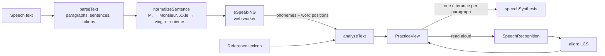

<p align="center"></p>

# Discours

A web app for practising French pronunciation of a speech. Paste your text and each word is shown
with its pronunciation in the International Phonetic Alphabet (IPA, *API* in French), plus the
liaisons to make. You can listen to a model voice, read aloud and see which words were understood,
then work on the difficult ones one by one.

The training screen and its engines follow an earlier single-page prototype,
*Entrainement prononciation*, generalized to any speech.

## Contents

- [Features](#features)
- [Getting started](#getting-started)
- [Writing a speech](#writing-a-speech)
- [How it works](#how-it-works)
- [Project structure](#project-structure)
- [Development](#development)
- [Limitations](#limitations)
- [Licence](#licence)

## Features

- **IPA under each word**, split into syllables (`/a.pʁɑ̃.ti.saʒ/`). It comes from a hand-checked
  lexicon when the word is in it, otherwise from eSpeak-NG.
- **Liaisons and enchaînements**: `‿z` after *les* in *les enfants*, `‿` after *avec* in
  *avec elle*.
- **Model voice**: the paragraph is read in a single utterance by the best French voice in the
  browser, and the word being spoken is highlighted. The rate is adjustable (0.6× to 1.1×).
- **Read aloud**: speech recognition follows your reading. Words turn green when understood and
  red when missed, live. At the end you get a score, the reading time and your words per minute
  (target ≈ 135).
- **Words to work on**: missed words are collected in a list. Click one (or any word in the text)
  to hear it, hear it slowly, and repeat it until it's recognized.
- **IPA corrections**: if a transcription is wrong, click the word and correct it. The correction
  applies everywhere the word appears.
- **Progress is saved** in the browser: best score per paragraph, words to work on, per-word
  success rate.

## Getting started

Requirements: Node.js 22.18+ or 24.12+.

```sh
npm install
npm run dev
```

Then open the URL shown by Vite **in Google Chrome or Microsoft Edge**. Speech recognition is not
available in Safari or Firefox; the model voice and the IPA still work there.

The microphone is needed for *Lire à voix haute* and *Répéter*. Allow it when the browser asks.

| Command              | What it does                                                    |
| -------------------- | --------------------------------------------------------------- |
| `npm run dev`        | Development server with hot reload                              |
| `npm run build`      | Type-check and production build in `dist/`                      |
| `npm run preview`    | Serve the production build                                      |
| `npm run lint`       | oxlint then ESLint, with fixes                                  |
| `npm run format`     | Prettier on `src/`                                              |
| `npm run espeak`     | Rebuild the French eSpeak-NG bundle (run by `dev` and `build`)  |
| `npm run docs`       | Generate the API documentation in `docs/api/` (TypeDoc)         |

## Writing a speech

Click **Modifier le texte** in the sidebar. The format is plain text:

```text
# Introduction
Mesdames et Messieurs les membres du jury, / je vous remercie de m'accueillir. //
Je vais d'abord vous présenter mon parcours. [→]
# Parcours
Depuis mon arrivée au laboratoire, / mes travaux portent sur…
```

- **One paragraph per line.** A paragraph is the unit you listen to, read and get scored on.
- **`# Title`** starts a section. Paragraphs are grouped under it in the sidebar.
- **`/`** marks a short pause and **`//`** a long one. The model voice respects them.
- **`[→]`** marks a slide change. It is shown but not read.

The text is saved as you type.

## How it works

### Overview



### IPA transcription

1. **Parsing** (`src/phonetics/normalize.ts`). The text is split into paragraphs, sentences and
   tokens (words, punctuation, reading marks), keeping the original spacing.
2. **Normalization.** eSpeak-NG reads some written forms badly, so they are rewritten first:
   *M.* → Monsieur, *XXIe* / *21e* → vingt-et-unième, *Louis XIV* → Louis 14, *PIB* → pé-i-bé,
   *1 200 000* → 1200000, *qu'aujourd'hui*. A character map keeps track of which original word
   each character comes from.
3. **Phonemization** (`src/phonetics/espeak.worker.ts`). eSpeak-NG runs in a web worker. Its
   synthesis events give every phoneme along with the position of the word that produced it,
   which is how the IPA is aligned word by word. The audio is thrown away.
4. **Choosing the IPA** (`src/phonetics/analyze.ts`). If the word is in the hand-checked lexicon
   (`src/phonetics/lexicon.ts`, about 600 hand-checked words split into syllables), its entry is
   used. Otherwise eSpeak's phonemes are cleaned up (stress marks removed, ɥ restored in *suis*,
   *nuit*) and split into syllables.
5. **Liaisons.** Every distinct word is also phonemized on its own. A final consonant that only
   appears in context is a liaison (*les* /le/, *les enfants* /lez‿ɑ̃fɑ̃/). A pronounced final
   consonant before a vowel is an enchaînement (*avec‿elle*).

The French eSpeak data is cut down from 23 MB (all languages) to about 700 KB by
`scripts/build-espeak-fr.mjs`. It loads in the background when the app starts, and a 750-word
speech is analyzed in under a second.

### Model voice

`src/composables/useSpeech.ts` uses the browser's speech synthesis, with the same voice choice as
the prototype: fr-FR voices, *Google français* first, then Thomas, Amélie, Denise or Henri. A
different voice can be picked in the toolbar.

The whole paragraph is spoken as **one utterance**, which keeps intonation natural across
sentences. `/` becomes a comma and `//` an ellipsis, which the voice reads as pauses. Word boundary
events drive the highlighting.

### Reading score

`src/composables/useRecognition.ts` runs continuous French speech recognition.
`src/practice/align.ts` aligns the transcript with the paragraph's words by longest common
subsequence, with a tolerant comparison. This is the prototype's algorithm:

- Words are compared without accents or punctuation.
- Elisions are matched part by part: *l'équipe* → `l` + `equipe`.
- Plural, feminine and verb endings are ignored (*arrivé* = *arrivés*).

A word is *understood* when all its parts were heard. Technical terms (acronyms such as *CNRS*,
alphanumeric terms) are shown in italics and **not counted** in the score: recognizers transcribe
them unpredictably. Only the best score of each paragraph is kept.

### Stored data

Everything is in the browser's `localStorage`, under the key `discours:v2`:

- the speech text;
- settings: IPA and liaison display, rate, voice;
- the current paragraph;
- best scores, words to work on, per-word practice statistics;
- IPA corrections.

Scores are tied to the paragraph text: editing a paragraph resets its score.

## Project structure

```text
scripts/
  build-espeak-fr.mjs     French-only eSpeak-NG bundle (data trimming + module patch)
src/
  phonetics/
    analyze.ts            analyzeText(): IPA, syllables, liaisons; worker client
    normalize.ts          tokenizer, sentence splitter, eSpeak-friendly rewriting
    numbers.ts            French numbers and ordinals in words, Roman numerals
    lexicon.ts            hand-checked IPA lexicon from the prototype
    espeak.worker.ts      web worker running eSpeak-NG
  practice/
    align.ts              transcript ↔ text alignment, word comparison
  composables/
    useSpeech.ts          model voice (speechSynthesis), voice choice, highlighting
    useRecognition.ts     speech recognition: continuous reading and single words
  stores/
    discours.ts           Pinia store: text, analysis, settings, progress (persisted)
  views/
    PracticeView.vue      training screen (route /)
    EditorView.vue        speech editor (route /texte)
  components/
    WordPractice.vue      single-word practice panel
  vendor/
    espeak-ng-fr.d.ts     types of the generated eSpeak module
    espeak-ng-fr.js       generated, git-ignored
public/espeak/            generated French data package, git-ignored
```

Every module, exported function and type is documented with
[TSDoc](https://tsdoc.org) comments. Start with `src/phonetics/analyze.ts`: its header describes
the whole pipeline. Run `npm run docs` to browse them as a website.

## Development

- **Stack:** Vue 3 (`<script setup>`), TypeScript, Pinia, Vue Router, Vite.
- **Code style:** Prettier (no semicolons, single quotes, 100 columns), checked by oxlint and
  ESLint.
- **Generated files:** `src/vendor/espeak-ng-fr.js` and `public/espeak/` are generated and ignored
  by git and the linters. Run `npm run espeak` if you upgrade `@echogarden/espeak-ng-emscripten`.
  The script fails loudly if the upstream module layout changes.
- **Testing the analyzer in Node:** `analyzeText(text, run)` accepts its phonemizer as a second
  argument. Load `src/vendor/espeak-ng-fr.js` in Node, with `locateFile` pointing to
  `public/espeak/`, and pass a function that calls `synthesize` and collects the phoneme events.
- **Adding IPA by hand:** add entries to `LEXICON` in `src/phonetics/lexicon.ts`, split into
  syllables with dots. Users can also correct words in the app, but those corrections stay in
  their browser.
- **API documentation:** `npm run docs` generates an HTML site in `docs/api/` with
  [TypeDoc](https://typedoc.org) (open `docs/api/index.html`). The configuration is in
  `typedoc.json`. TypeDoc uses `tsconfig.docs.json`, which only includes the TypeScript modules,
  since it cannot read `.vue` files. To document a new module, add it to `entryPoints`.

## Limitations

- **Speech recognition** only works in Chrome and Edge, and sends the audio to the browser
  vendor's servers. It judges whether a word was *understood*, not whether it was perfectly
  pronounced.
- **The lexicon ignores context.** It gives *tous* /tu/ even in *à tous* (/tus/), and only covers
  the vocabulary of the speech it was written for.
- **eSpeak-NG makes occasional mistakes** (*fils* /fil/ instead of /fis/) and makes some optional
  liaisons (*arrivés‿z en*). Click a word to correct it.
- **The model voice depends on the browser and the system.** Chrome's *Google français* and
  macOS's Thomas or Amélie sound best.
- **Fonts** (IBM Plex, Charis SIL) load from Google Fonts. Offline, system fonts are used.

## Licence

Discours is free software, released under the GNU General Public License, version 3 or (at your
option) any later version. It bundles eSpeak-NG, which is under the same licence. See
[LICENSE](LICENSE) for the full terms.
